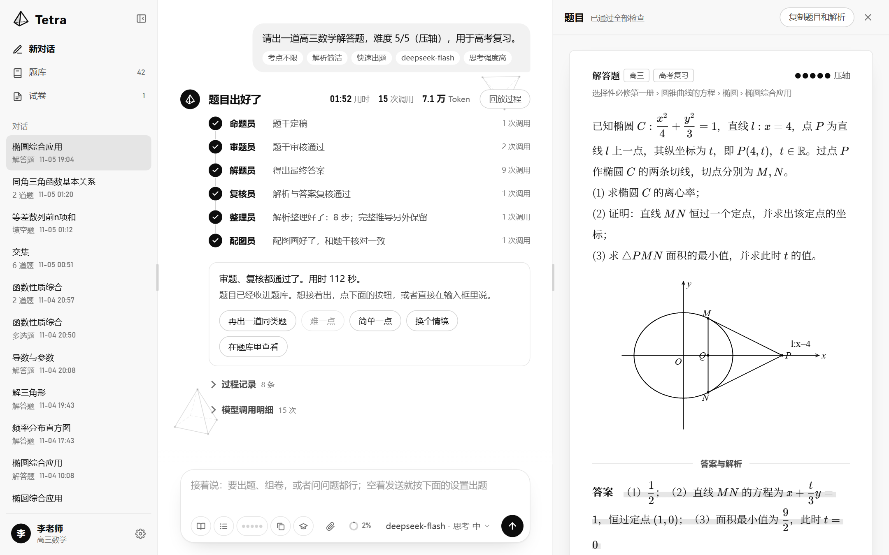
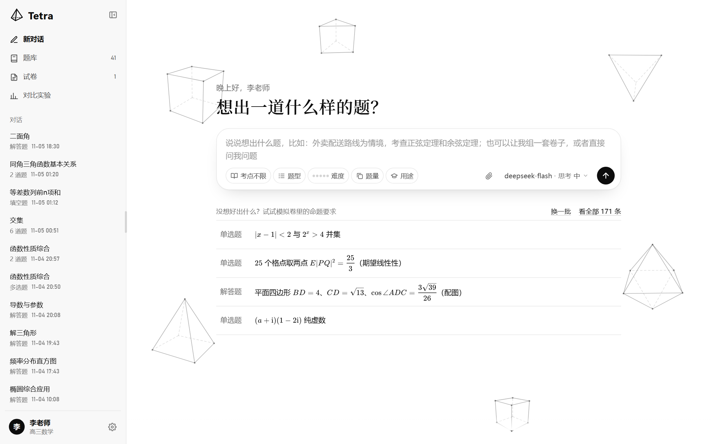
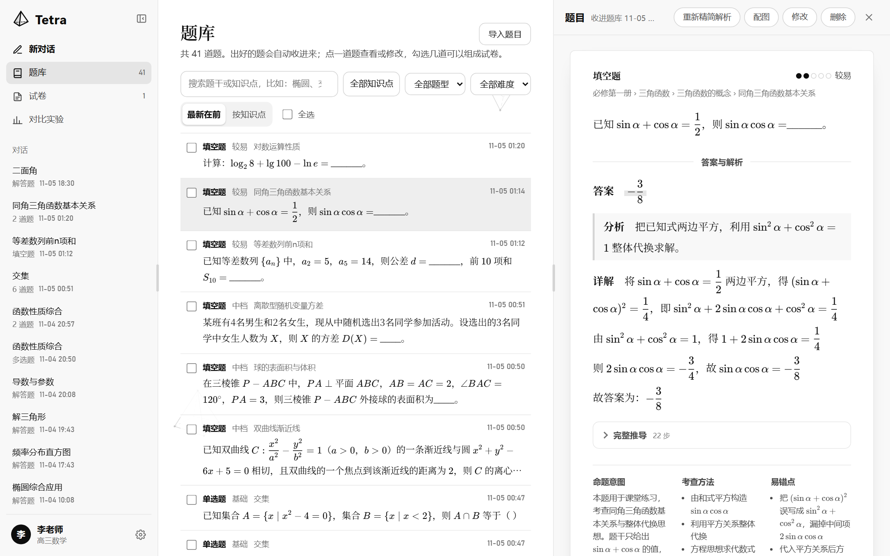
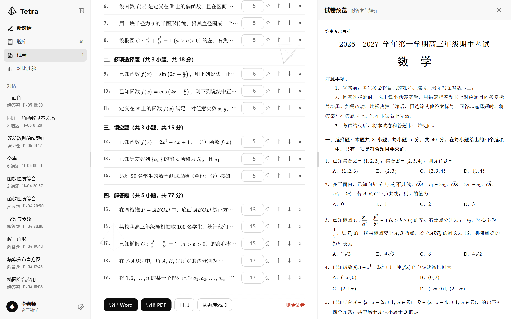
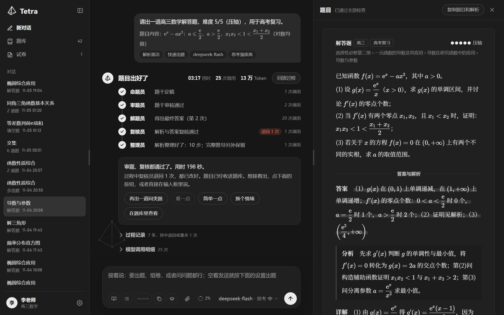
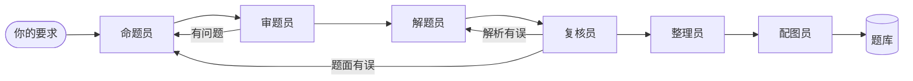

<div align="center">


# Tetra

**会自己审题、解题和复核的高中数学命题智能体**

一句话出题、组卷、导出试卷。每道题都经过多个 AI 角色独立求解和交叉核对，通过了才交到你手上。

[](https://www.python.org/) [](https://fastapi.tiangolo.com/)  

[快速开始](#快速开始) · [功能](#功能) · [工作原理](#工作原理) · [使用手册](docs/user-guide.md) · [架构说明](docs/architecture.md) · [开发指南](docs/development.md)

</div>

<br>



## 简介

让大模型写一道数学题只要几秒钟，但写出来的题可能条件矛盾、答案算错、解法超纲，老师还是要逐题验算，再一点点排版。

Tetra 把出题拆成一条流水线：命题员写题，审题员和复核员只看题面各自重新求解，答案对不上就退回重做；解题员只能用高中方法；配图由程序按坐标绘制，再和题干核对。全部通过的题自动收进题库，可以继续组成标准试卷，导出 Word 或 PDF。

Tetra 运行在你自己的电脑上，题库和试卷都存在本机，模型服务由你自己选。名字取自正四面体（tetrahedron）：四个面对应命题、审题、解题、复核四个互相把关的角色。

## 为什么选择 Tetra

- **答案要对得上才算数。** 审题员、复核员和可选的验算员都从题面独立求解，和解析的答案对不上就退回修改。
- **返工不是抽奖。** 每次退回都带着具体原因交给下一个角色：复核退回后，解题员按意见只改出错的步骤；整道题重出时，命题员看得到上一版为什么被退回。到了上限，手里有写完的解析就交付最好的一版，并写明还有哪些意见要核对。
- **超纲方法会被拦下，但不会因此出不成。** 按人教 A 版、B 版的知识体系出题，覆盖 302 个知识点；解析用了定积分、洛必达法则、泰勒展开这类方法时，复核员先判断有没有高中解法：有，就把做法交给解题员改；解题员和复核员都认为只能用大学方法，就带着改题建议退回命题员改题。
- **一句话走完全流程。** 说“组一套高一期末试卷”，它会定双向细目表、从题库挑题、现场补齐缺的题，再排成标准试卷。
- **格式不用再调。** 解析按【分析】【详解】的试卷格式整理；试卷按高考版式排版；Word 里的公式是原生公式，可以继续修改。
- **过程看得见。** 每个角色的进度、每条审题意见和退回原因都有记录，还能回放整个出题过程。想停随时停，点一下就断开正在进行的模型请求。
- **模型和数据都在你手里。** DeepSeek、智谱 GLM、OpenAI、Claude 填上 API Key 就能用，其他兼容 OpenAI 接口的服务也能接入；题库和试卷只存在本机。

| | 通用 AI 聊天 | Tetra |
|---|---|---|
| 题目对不对 | 自己验算 | 多个角色从题面独立求解，发现问题就按意见修改 |
| 是否超纲 | 自己检查 | 自动检查超纲方法，按复核员的判断改用高中方法或改题 |
| 配图 | 另找工具画 | 程序按坐标绘制，虚线自动处理，并和题干核对 |
| 解析 | 长短不一 | 整理成标准答案格式，完整推导另外保留 |
| 组卷 | 逐题复制粘贴 | 一句话组卷，题库不够时现场补题 |
| 排版 | 手工调整 | 高考版式，Word 原生公式，PDF 直接打印 |
| 题目积累 | 留在聊天记录里 | 自动进题库，按教材的册、章、节、考点分类 |

## 界面

<table>
  <tr>
    <td width="50%"></td>
    <td width="50%"></td>
  </tr>
  <tr>
    <td align="center">首页：用自然语言提要求，公式和题目一样排版</td>
    <td align="center">题库：按知识点管理，随时修改、精简解析、重画配图</td>
  </tr>
  <tr>
    <td width="50%"></td>
    <td width="50%"></td>
  </tr>
  <tr>
    <td align="center">试卷：高考版式，所见即所得，一键导出</td>
    <td align="center">夜晚主题</td>
  </tr>
</table>

## 功能

**智能出题**

- 用自然语言提要求，或者选考点、题型、难度、题量和用途
- 一次最多出 20 道，同一批题互不重复
- 出完接着说，或者点“再出一道同类题”“难一点”“简单一点”“换个情境”
- 三种预设的出题方式（快速、多一道把关、最严格），四档思考强度
- 自动配图：立体图、函数图象、统计图

**组卷与导出**

- 一句话自动组卷，题库不够时现场补题
- 手动组卷，调整分值和顺序，A4 实时预览
- 练习卷和标准试卷两种版式，答案和双向细目表可以另起一份
- 导出 Word（原生公式）和 PDF，也可以直接打印

**识题与解题**

- 粘贴、拖入或上传图片、PDF、文本
- 看图解题，当前模型不能看图时自动换一个能看图的模型
- 批量导入试卷和讲义：跨页的题和解答自动接上，配图从原文件截取
- 原题没有解析时由模型补写，确认后才存进题库

**题库与对话**

- 出好的题自动入库，按“册 › 章 › 节 › 考点”分类，可以搜索、筛选和修改
- 一个输入框完成所有事：自动判断是聊天、出题、组卷还是存题
- 每个对话都有上下文记忆，用量可见，快满时自动压缩

**界面与设置**

- 黑白简洁的三栏界面，宽度可拖动；白天 / 夜晚主题；中文 / English
- 设置任教年级、教材版本和默认的出题偏好
- 可选的偏好学习：根据出题记录提建议，你采用了才生效

## 工作原理



| 角色 | 做什么 |
|---|---|
| 命题员 | 先选定数学对象、算出答案，再写题干 |
| 审题员 | 检查条件、范围和表述，并只看题面独立求解 |
| 解题员 | 先定好关键中间结果，再分段写解析，只用高中方法 |
| 复核员 | 从题面重新求解，题面有错退回命题员，解析有错退回解题员 |
| 验算员（可选） | 只看题面独立解题，再和解析的答案核对 |
| 整理员 | 把完整推导改写成标准答案格式，完整推导另外保留 |
| 配图员 | 写出图纸，由程序绘图，再按坐标和题干核对 |

复核退回时，解题员拿到具体意见后只改出错的步骤，不会整份重写。每道题都有调用次数和时间上限；到了上限还有意见没解决，就把最好的一版交给你并标明“待核对”，写清楚还有哪些问题。

可以同时试 1～3 个方案，先通过全部检查的被采用。更多细节见[架构说明](docs/architecture.md)。

技术栈：FastAPI、原生 JavaScript（无需构建）、KaTeX、SQLite。

## 快速开始

### 环境要求

- Python 3.10 及以上（目前在 Windows 11 上开发和测试）
- 一个模型服务的 API Key；看图解题和识题需要支持图片输入的模型
- 可选：Microsoft Word，用来生成 Word 原生公式；Edge 或 Chrome，用来导出 PDF

### 安装并运行

```bash
git clone https://github.com/DarkMoonWarrior/Tetra.git
cd Tetra
python -m pip install -e .
tetra
```

第一次运行时，`tetra` 会在项目里创建 `.venv` 并安装依赖，然后打开浏览器（http://127.0.0.1:8765）。

### 接入模型

在页面上打开「个人设置 → 模型服务」，选一个模板，填上 API Key 就能用。不用改配置文件，也不用重启。

## 支持的模型服务

| 服务 | 接入方式 | 需要填写 |
|---|---|---|
| DeepSeek | 内置模板 | API Key |
| 智谱 GLM | 内置模板 | API Key |
| OpenAI | 内置模板 | API Key |
| Claude | 内置模板，使用 Anthropic 官方 SDK | API Key |
| 其他兼容 OpenAI 接口的服务（通义千问、Kimi、学校或公司内部服务等） | 手动接入 | 接口地址、API Key |

可以同时接入好几家，并为出题和把关分别指定模型。

## 常见问题

**出一道题要多久？**
基础题通常半分钟左右，压轴题要几分钟，取决于模型和思考强度。

**要花多少钱？**
费用由你接入的模型服务收取。一道题通常消耗几万到十几万 Token，题目越难、检查越严，用量越大。

**出的题一定正确吗？**
不能保证。多角色核对能减少错误，但模型仍可能出错，用于教学和考试之前请老师审阅。

**能多人一起用吗？**
目前是单机应用，没有账号和权限控制，每个人在自己的电脑上运行，数据各自一份。

## 数据与隐私

- 服务只监听 `127.0.0.1`，不对外开放。
- 题库、试卷、个人设置和 API Key 都保存在本机的 `data/runtime/`，不进版本库。
- 出题、聊天和识题时，你的要求和附件会发给你接入的模型服务。

## 文档

| 文档 | 内容 |
|---|---|
| [使用手册](docs/user-guide.md) | 启动选项、模型配置、出题、组卷、识题和各项设置 |
| [架构说明](docs/architecture.md) | 系统结构、出题流水线、项目目录和 API 概览 |
| [开发指南](docs/development.md) | 本地开发、界面翻译、运行数据和流程评测 |

## 参与贡献

欢迎提交 Issue 和 Pull Request。开始之前可以先看[开发指南](docs/development.md)。

## 致谢

- 命题流程的“概念 → 思路 → 题目”参考了 PromptCoT。
- 公式渲染使用 [KaTeX](https://katex.org/)，PDF 渲染使用 [PyMuPDF](https://pymupdf.readthedocs.io/)，Word 导出使用 [python-docx](https://python-docx.readthedocs.io/) 和 [latex2mathml](https://github.com/roniemartinez/latex2mathml)。
