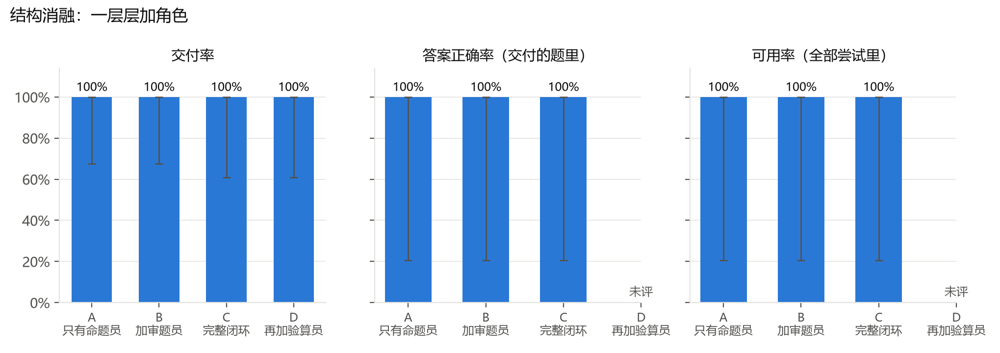
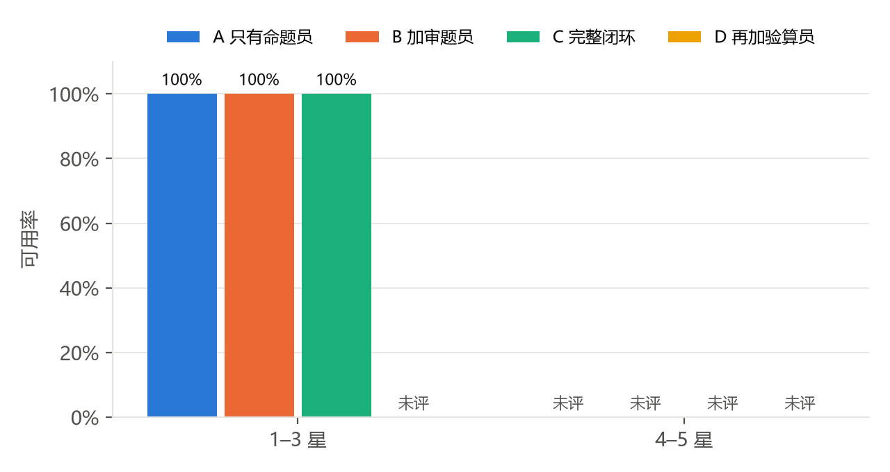
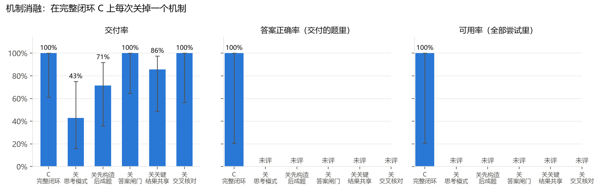
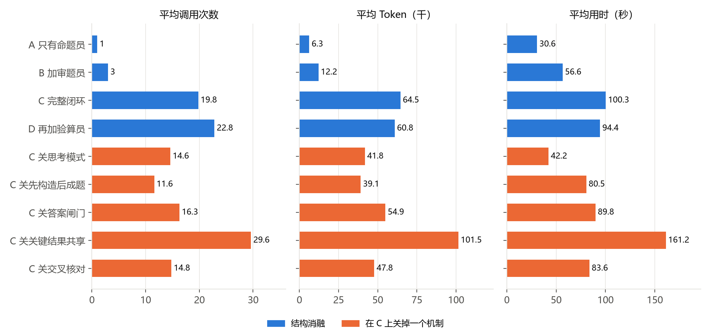

# 结果表（pilot，61 次出题）

| 配置 | 题数 | 交付率 | 答案正确率 | 可用率 | 题目不成立 | 平均调用 | 平均 Token | 平均用时 | 每道可用题花费 | 超纲（交付/拦下） | 考点符合 | 难度差≤1 | 和 C 逐题比（C 独有/它独有，p） |
|---|---|---|---|---|---|---|---|---|---|---|---|---|---|
| A 只有命题员 | 8 | 100% | 100%（1/1） | 100% | 0 | 1 | 6.3k | 30.6 秒 | $0.0261 | 0/0 | 100% | 100% | 0/0，p=1.0 |
| B 加审题员 | 8 | 100% | 100%（1/1） | 100% | 0 | 3 | 12.2k | 56.6 秒 | $0.0477 | 0/0 | 100% | 100% | 0/0，p=1.0 |
| C 完整闭环 | 6 | 100% | 100%（1/1） | 100% | 0 | 19.8 | 64.5k | 100.3 秒 | $0.0909 | 0/0 | 100% | 100% | — |
| D 再加验算员 | 6 | 100% | 未评 | 未评 | 0 | 22.8 | 60.8k | 94.4 秒 | — | 0/0 | 未评 | 未评 | 未评 |
| C 关思考模式 | 7 | 43% | 未评 | 未评 | 0 | 14.6 | 41.8k | 42.2 秒 | — | 0/1 | 未评 | 未评 | 未评 |
| C 关先构造后成题 | 7 | 71% | 未评 | 未评 | 0 | 11.6 | 39.1k | 80.5 秒 | — | 0/0 | 未评 | 未评 | 未评 |
| C 关答案闸门 | 7 | 100% | 未评 | 未评 | 0 | 16.3 | 54.9k | 89.8 秒 | — | 0/0 | 未评 | 未评 | 未评 |
| C 关关键结果共享 | 7 | 86% | 未评 | 未评 | 0 | 29.6 | 101.5k | 161.2 秒 | — | 0/1 | 未评 | 未评 | 未评 |
| C 关交叉核对 | 5 | 100% | 未评 | 未评 | 0 | 14.8 | 47.8k | 83.6 秒 | — | 0/0 | 未评 | 未评 | 未评 |

## 1–3 星

| 配置 | 题数 | 交付率 | 答案正确率 | 可用率 | 题目不成立 | 平均调用 | 平均 Token | 平均用时 | 每道可用题花费 | 超纲（交付/拦下） | 考点符合 | 难度差≤1 | 和 C 逐题比（C 独有/它独有，p） |
|---|---|---|---|---|---|---|---|---|---|---|---|---|---|
| A 只有命题员 | 5 | 100% | 100%（1/1） | 100% | 0 | 1 | 5.6k | 25.6 秒 | $0.0142 | 0/0 | 100% | 100% | 0/0，p=1.0 |
| B 加审题员 | 5 | 100% | 100%（1/1） | 100% | 0 | 3 | 9.6k | 39.6 秒 | $0.0220 | 0/0 | 100% | 100% | 0/0，p=1.0 |
| C 完整闭环 | 4 | 100% | 100%（1/1） | 100% | 0 | 18.5 | 57.3k | 95.8 秒 | $0.0557 | 0/0 | 100% | 100% | — |
| D 再加验算员 | 4 | 100% | 未评 | 未评 | 0 | 25.5 | 63.7k | 102.8 秒 | — | 0/0 | 未评 | 未评 | 未评 |
| C 关思考模式 | 4 | 75% | 未评 | 未评 | 0 | 10.8 | 23.2k | 22.8 秒 | — | 0/0 | 未评 | 未评 | 未评 |
| C 关先构造后成题 | 4 | 100% | 未评 | 未评 | 0 | 14.2 | 40.8k | 71.5 秒 | — | 0/0 | 未评 | 未评 | 未评 |
| C 关答案闸门 | 4 | 100% | 未评 | 未评 | 0 | 17.5 | 50.9k | 70.1 秒 | — | 0/0 | 未评 | 未评 | 未评 |
| C 关关键结果共享 | 4 | 100% | 未评 | 未评 | 0 | 25.8 | 74.6k | 111.8 秒 | — | 0/0 | 未评 | 未评 | 未评 |
| C 关交叉核对 | 4 | 100% | 未评 | 未评 | 0 | 13.8 | 42.2k | 76.8 秒 | — | 0/0 | 未评 | 未评 | 未评 |

## 4–5 星

| 配置 | 题数 | 交付率 | 答案正确率 | 可用率 | 题目不成立 | 平均调用 | 平均 Token | 平均用时 | 每道可用题花费 | 超纲（交付/拦下） | 考点符合 | 难度差≤1 | 和 C 逐题比（C 独有/它独有，p） |
|---|---|---|---|---|---|---|---|---|---|---|---|---|---|
| A 只有命题员 | 3 | 100% | 未评 | 未评 | 0 | 1 | 7.5k | 39.0 秒 | — | 0/0 | 未评 | 未评 | 未评 |
| B 加审题员 | 3 | 100% | 未评 | 未评 | 0 | 3 | 16.4k | 85.0 秒 | — | 0/0 | 未评 | 未评 | 未评 |
| C 完整闭环 | 2 | 100% | 未评 | 未评 | 0 | 22.5 | 79.0k | 109.2 秒 | — | 0/0 | 未评 | 未评 | — |
| D 再加验算员 | 2 | 100% | 未评 | 未评 | 0 | 17.5 | 55.1k | 77.7 秒 | — | 0/0 | 未评 | 未评 | 未评 |
| C 关思考模式 | 3 | 0% | 未评 | 0% | 0 | 19.7 | 66.6k | 68.2 秒 | — | 0/1 | 未评 | 未评 | 未评 |
| C 关先构造后成题 | 3 | 33% | 未评 | 未评 | 0 | 8 | 36.9k | 92.4 秒 | — | 0/0 | 未评 | 未评 | 未评 |
| C 关答案闸门 | 3 | 100% | 未评 | 未评 | 0 | 14.7 | 60.4k | 116.2 秒 | — | 0/0 | 未评 | 未评 | 未评 |
| C 关关键结果共享 | 3 | 67% | 未评 | 未评 | 0 | 34.7 | 137.4k | 227.0 秒 | — | 0/1 | 未评 | 未评 | 未评 |
| C 关交叉核对 | 1 | 100% | 未评 | 未评 | 0 | 19 | 70.3k | 110.6 秒 | — | 0/0 | 未评 | 未评 | 未评 |

## 按试跑估计正式实验（60 道题 × 9 种配置）

| 配置 | 出题花费（闲时） | 评判花费（闲时） | 每次出题平均用时 |
|---|---|---|---|
| A 只有命题员 | $0.26 | $0.19 | 41 秒 |
| B 加审题员 | $0.34 | $0.19 | 54 秒 |
| C 完整闭环 | $0.63 | $0.12 | 108 秒 |
| D 再加验算员 | $0.58 | $0.12 | 97 秒 |
| C 关思考模式 | $0.32 | $0.06 | 41 秒 |
| C 关先构造后成题 | $0.41 | $0.09 | 77 秒 |
| C 关答案闸门 | $0.51 | $0.12 | 87 秒 |
| C 关关键结果共享 | $0.99 | $0.11 | 166 秒 |
| C 关交叉核对 | $0.48 | $0.12 | 84 秒 |
| **合计** | **$4.53** | **$1.14** | |

出题：各次用时加起来约 8.7 小时；试跑时同时出 10 道，实际并行度约 6.4，照此约需 1.4 小时。评判：同时评 6 道，约 0.2 小时。高峰时段（北京时间工作日 9–12 点、14–18 点）价格翻倍。

评判花费按试跑里评过的 3 道题估计。

试跑里没有数据、上面没算进去：C 完整闭环的解答题、D 再加验算员的解答题、C 关思考模式的解答题、C 关先构造后成题的解答题、C 关答案闸门的解答题、C 关关键结果共享的解答题、C 关交叉核对的解答题。试跑补齐后再运行一次 report.py 就会算进去。

## 图

