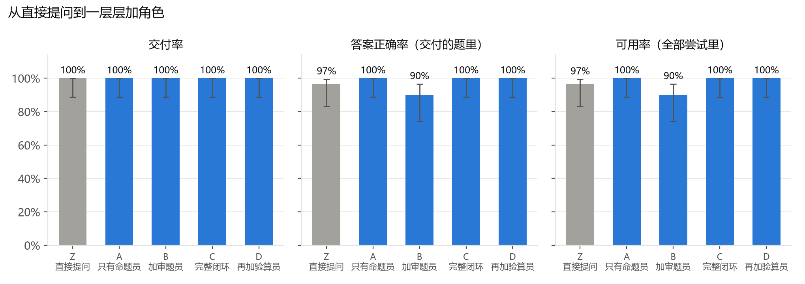
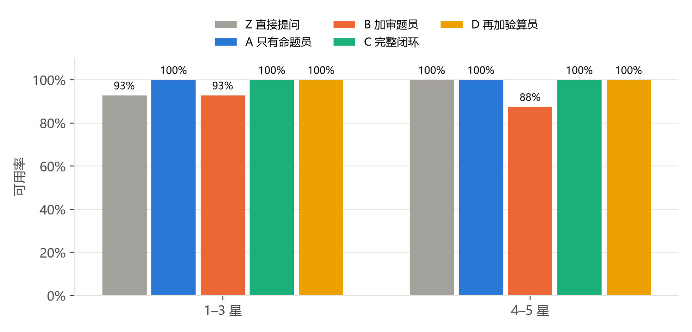
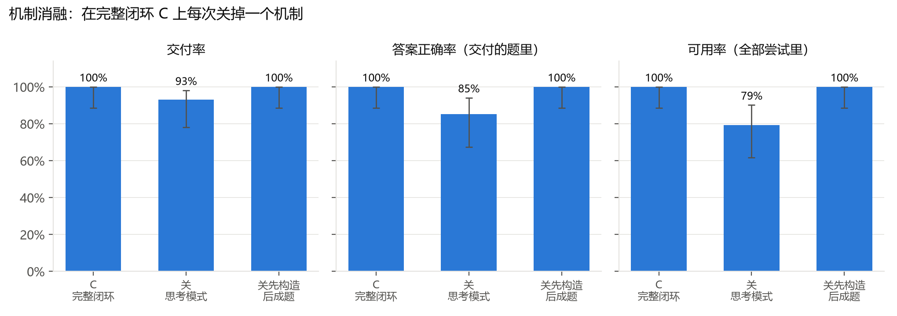
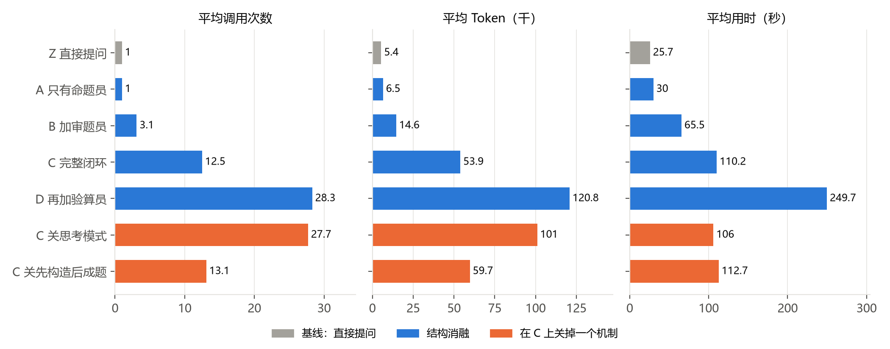

# 结果表（small，209 次出题）

| 配置 | 题数 | 交付率 | 答案正确率 | 可用率 | 题目不成立 | 平均调用 | 平均 Token | 平均用时 | 每道可用题花费 | 超纲（交付/拦下） | 考点符合 | 难度差≤1 | 和 C 逐题比（C 独有/它独有，p） |
|---|---|---|---|---|---|---|---|---|---|---|---|---|---|
| Z 直接提问 | 30 | 100% | 97%（29/30） | 97% | 1 | 1 | 5.4k | 25.7 秒 | $0.0031 | 1/0 | 93% | 100% | 1/0，p=1.0 |
| A 只有命题员 | 30 | 100% | 100%（30/30） | 100% | 0 | 1 | 6.5k | 30.0 秒 | $0.0034 | 0/0 | 97% | 97% | 0/0，p=1.0 |
| B 加审题员 | 30 | 100% | 90%（27/30） | 90% | 0 | 3.1 | 14.6k | 65.5 秒 | $0.0081 | 0/0 | 97% | 100% | 3/0，p=0.25 |
| C 完整闭环 | 30 | 100% | 100%（30/30） | 100% | 0 | 12.5 | 53.9k | 110.2 秒 | $0.0160 | 0/0 | 97% | 100% | — |
| D 再加验算员 | 30 | 100% | 100%（30/30） | 100% | 0 | 28.3 | 120.8k | 249.7 秒 | $0.0360 | 0/0 | 100% | 100% | 0/0，p=1.0 |
| C 关思考模式 | 29 | 93% | 85%（23/27） | 79% | 3 | 27.7 | 101.0k | 106.0 秒 | $0.0262 | 0/0 | 89% | 100% | 6/0，p=0.031 |
| C 关先构造后成题 | 30 | 100% | 100%（30/30） | 100% | 0 | 13.1 | 59.7k | 112.7 秒 | $0.0168 | 0/0 | 97% | 100% | 0/0，p=1.0 |

## 1–3 星

| 配置 | 题数 | 交付率 | 答案正确率 | 可用率 | 题目不成立 | 平均调用 | 平均 Token | 平均用时 | 每道可用题花费 | 超纲（交付/拦下） | 考点符合 | 难度差≤1 | 和 C 逐题比（C 独有/它独有，p） |
|---|---|---|---|---|---|---|---|---|---|---|---|---|---|
| Z 直接提问 | 14 | 100% | 93%（13/14） | 93% | 1 | 1 | 3.0k | 13.8 秒 | $0.0017 | 0/0 | 93% | 100% | 1/0，p=1.0 |
| A 只有命题员 | 14 | 100% | 100%（14/14） | 100% | 0 | 1 | 4.5k | 20.2 秒 | $0.0022 | 0/0 | 100% | 93% | 0/0，p=1.0 |
| B 加审题员 | 14 | 100% | 93%（13/14） | 93% | 0 | 3.3 | 13.9k | 60.5 秒 | $0.0072 | 0/0 | 100% | 100% | 1/0，p=1.0 |
| C 完整闭环 | 14 | 100% | 100%（14/14） | 100% | 0 | 11.2 | 35.7k | 69.1 秒 | $0.0098 | 0/0 | 100% | 100% | — |
| D 再加验算员 | 14 | 100% | 100%（14/14） | 100% | 0 | 22.3 | 72.3k | 145.2 秒 | $0.0204 | 0/0 | 100% | 100% | 0/0，p=1.0 |
| C 关思考模式 | 14 | 100% | 93%（13/14） | 93% | 1 | 21 | 57.1k | 62.2 秒 | $0.0124 | 0/0 | 93% | 100% | 1/0，p=1.0 |
| C 关先构造后成题 | 14 | 100% | 100%（14/14） | 100% | 0 | 10.6 | 33.8k | 63.2 秒 | $0.0092 | 0/0 | 93% | 100% | 0/0，p=1.0 |

## 4–5 星

| 配置 | 题数 | 交付率 | 答案正确率 | 可用率 | 题目不成立 | 平均调用 | 平均 Token | 平均用时 | 每道可用题花费 | 超纲（交付/拦下） | 考点符合 | 难度差≤1 | 和 C 逐题比（C 独有/它独有，p） |
|---|---|---|---|---|---|---|---|---|---|---|---|---|---|
| Z 直接提问 | 16 | 100% | 100%（16/16） | 100% | 0 | 1 | 7.6k | 36.1 秒 | $0.0043 | 1/0 | 94% | 100% | 0/0，p=1.0 |
| A 只有命题员 | 16 | 100% | 100%（16/16） | 100% | 0 | 1 | 8.3k | 38.6 秒 | $0.0044 | 0/0 | 94% | 100% | 0/0，p=1.0 |
| B 加审题员 | 16 | 100% | 88%（14/16） | 88% | 0 | 2.9 | 15.3k | 70.0 秒 | $0.0090 | 0/0 | 94% | 100% | 2/0，p=0.5 |
| C 完整闭环 | 16 | 100% | 100%（16/16） | 100% | 0 | 13.6 | 69.8k | 146.2 秒 | $0.0214 | 0/0 | 94% | 100% | — |
| D 再加验算员 | 16 | 100% | 100%（16/16） | 100% | 0 | 33.6 | 163.3k | 341.1 秒 | $0.0496 | 0/0 | 100% | 100% | 0/0，p=1.0 |
| C 关思考模式 | 15 | 87% | 77%（10/13） | 67% | 2 | 33.9 | 142.1k | 146.8 秒 | $0.0441 | 0/0 | 85% | 100% | 5/0，p=0.062 |
| C 关先构造后成题 | 16 | 100% | 100%（16/16） | 100% | 0 | 15.2 | 82.4k | 156.0 秒 | $0.0234 | 0/0 | 100% | 100% | 0/0，p=1.0 |

## 图

